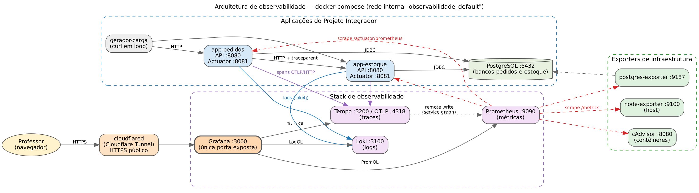

# Observabilidade com Actuator, Prometheus, Grafana, Loki e Tempo

Projeto de Avaliação da disciplina **Infraestrutura de Comunicação**, prof. Luiz Novaes.

As aplicações web Java do Projeto Integrador expõem métricas pelo **Spring Boot Actuator / Micrometer**. O **Prometheus** coleta essas métricas e as de infraestrutura (**Node Exporter**, **cAdvisor**, **postgres_exporter**). Os logs vão para o **Loki** e os traces para o **Tempo**, e tudo aparece num único **Grafana**, que é o único serviço acessível remotamente.



## Equipe

| Integrante | Papel |
| --- | --- |
| Ewerton Guilherme da Silva | Product Owner |
| Pablo Arthur Eustáquio de Lima | Backend Developer |
| João Ricardo Alves de Brito | Backend Developer |
| Lucas Aprigio dos Santos | Backend Developer |
| Saulo Eduardo Almeida dos Santos | Backend Developer |
| Thiago Cardozo da Conceição | Frontend / UI Designer |
| Eloi de Lima Sousa | Frontend / UI Designer |

## Pré-requisitos

- Docker 24+ com Docker Compose v2 (`docker compose version`)
- Git
- 4 GB de RAM livres para os contêineres
- Linux recomendado. No Docker Desktop (Windows/macOS) o Node Exporter e o cAdvisor medem a VM do Docker, e não a máquina física; isso é aceito na avaliação e está explicado no relatório.

Não é preciso ter Java ou Maven instalados, porque as imagens das aplicações são compiladas dentro do Docker (build multi-stage).

## Como subir o ambiente

```bash
git clone https://github.com/egs3-coder/Projeto-de-Avalia-o.git
cd Projeto-de-Avalia-o

# 1. Crie o .env e TROQUE as senhas (o .env não é versionado)
cp .env.example .env
nano .env

# 2. Suba tudo com um único comando
docker compose up -d --build

# 3. Confira os contêineres (todos "running"/"healthy"; grafana-init termina com "Exited (0)")
docker compose ps
```

A primeira subida demora alguns minutos por causa do build Maven das aplicações. O contêiner `gerador-carga` começa a gerar tráfego assim que o `app-pedidos` fica saudável, então os gráficos já aparecem com dados.

### Acesso remoto (professor)

```bash
# URL temporária gratuita via Cloudflare Tunnel (não precisa de conta)
docker compose --profile remoto up -d
docker compose logs cloudflared | grep -o 'https://.*trycloudflare.com'
```

Para ter uma **URL fixa**, crie um túnel nomeado no painel *Cloudflare Zero Trust → Networks → Tunnels*, aponte o hostname público para `http://grafana:3000`, cole o token em `CLOUDFLARE_TUNNEL_TOKEN` no `.env` e rode `docker compose --profile remoto-fixo up -d`.

O usuário **Viewer** do professor é criado automaticamente pelo serviço `grafana-init`, com as credenciais `GRAFANA_VIEWER_USER` / `GRAFANA_VIEWER_PASSWORD` do `.env`. As credenciais são informadas **somente no PDF / Google Classroom**.

## Portas e URLs

| Serviço | URL | Exposição | O que verificar |
| --- | --- | --- | --- |
| **Grafana** | http://localhost:3000 | **pública** (única) | Dashboards da pasta *Projeto Integrador* |
| Prometheus | http://localhost:9090/targets | só localhost | Todos os *targets* em **UP** |
| app-pedidos (API) | http://localhost:8080/api/pedidos | só localhost | Lista de pedidos |
| app-pedidos (Actuator) | http://localhost:8081/actuator/prometheus | só localhost | Métricas `pedidos_*`, `http_server_requests_*`, `hikaricp_*` |
| app-estoque (API) | http://localhost:8082/api/produtos | só localhost | Lista de produtos |
| app-estoque (Actuator) | http://localhost:8083/actuator/prometheus | só localhost | Métricas `estoque_*` |
| Loki | http://localhost:3100/ready | só localhost | `ready` |
| Tempo | http://localhost:3200/ready | só localhost | `ready` |
| node-exporter, cAdvisor, postgres-exporter | — | só rede interna do Docker | Coletados pelo Prometheus |

As portas marcadas como "só localhost" estão presas a `127.0.0.1` no `docker-compose.yml`, então não ficam acessíveis pela rede nem pela internet. O Actuator roda numa porta separada (8081) da API (8080).

## Comandos de validação (evidências)

```bash
# E1: endpoint Prometheus de cada aplicação, com a tag application
curl -s http://localhost:8081/actuator/prometheus | grep -E 'application="app-pedidos"' | head
curl -s http://localhost:8083/actuator/prometheus | grep -E 'application="app-estoque"' | head

# Métricas de negócio
curl -s http://localhost:8081/actuator/prometheus | grep -E '^pedidos_'
curl -s http://localhost:8083/actuator/prometheus | grep -E '^estoque_'

# Gerar carga manual, incluindo erros (além do gerador automático)
for i in $(seq 1 50); do
  curl -s -X POST http://localhost:8080/api/pedidos -H 'Content-Type: application/json' \
       -d '{"produtoId": 1, "quantidade": 2}' > /dev/null
done
for i in $(seq 1 10); do curl -s http://localhost:8080/api/pedidos/erro > /dev/null; done

# E3: todos os targets UP
curl -s http://localhost:9090/api/v1/targets | grep -o '"health":"[a-z]*"' | sort | uniq -c
```

Consultas úteis:

| Onde | Consulta |
| --- | --- |
| Prometheus | `sum by (uri) (rate(http_server_requests_seconds_count{application="app-pedidos"}[1m]))` |
| Prometheus | `histogram_quantile(0.95, sum by (le) (rate(http_server_requests_seconds_bucket{application="app-pedidos"}[5m])))` |
| Grafana → Explore → Loki | `{application="app-pedidos"}` |
| Grafana → Explore → Loki | `{application=~"app-.*", level="ERROR"}` |
| Grafana → Explore → Tempo (TraceQL) | `{resource.service.name="app-pedidos" && name="http post /api/pedidos"}` |

**Navegação log → trace:** no Explore (Loki), abra uma linha de log, clique no link **"Abrir trace no Tempo"** ao lado do `traceId`, e o trace completo abre ao lado. Do trace, o botão **"Logs for this span"** faz o caminho inverso.

## Aplicações instrumentadas

| Aplicação | Descrição | Endpoints |
| --- | --- | --- |
| `app-pedidos` | Cria pedidos e chama o `app-estoque` para reservar os produtos | `POST /api/pedidos`, `GET /api/pedidos`, `GET /api/pedidos/{id}`, `GET /api/pedidos/erro` |
| `app-estoque` | Controla o estoque de produtos (PostgreSQL) | `GET /api/produtos`, `GET /api/produtos/{id}`, `POST /api/produtos/{id}/reservar?quantidade=N`, `POST /api/produtos/{id}/repor?quantidade=N`, `GET /api/produtos/erro` |

Fluxo com vários spans: `POST /api/pedidos` (app-pedidos) → `pedido-service#criar` → chamada HTTP → `POST /api/produtos/{id}/reservar` (app-estoque) → `estoque-service#reservar` → consultas JDBC no PostgreSQL → `INSERT` do pedido.

O que cada aplicação usa:

- `spring-boot-starter-actuator` + `micrometer-registry-prometheus` expõem `health`, `info`, `metrics` e `prometheus`, com a tag `application=<nome>` (R1/R2).
- `micrometer-tracing-bridge-otel` + `opentelemetry-exporter-otlp` enviam traces ao Tempo via OTLP/HTTP, com 100% de amostragem (R6).
- `datasource-micrometer-spring-boot` cria spans das consultas JDBC.
- `loki-logback-appender` envia os logs ao Loki com os labels `application`, `host` e `level`; o `traceId` vai em cada linha (R6).
- O pool HikariCP gera as métricas `hikaricp_connections_*` (R2).

## Métricas de negócio (ponto adicional)

| Aplicação | Métrica (Prometheus) | Tipo | O que mede |
| --- | --- | --- | --- |
| app-pedidos | `pedidos_criados_total{status}` | Counter | Pedidos criados, por status (`aprovado` / `rejeitado`) |
| app-pedidos | `pedidos_processamento_seconds_*` | Timer | Tempo para processar um pedido (inclui a reserva no estoque), com p95 |
| app-pedidos | `pedidos_em_processamento` | Gauge | Pedidos sendo processados no momento |
| app-pedidos | `pedidos_itens_vendidos_total` | Counter | Unidades vendidas em pedidos aprovados |
| app-estoque | `estoque_reservas_total{resultado}` | Counter | Reservas por resultado (`sucesso` / `insuficiente`) |
| app-estoque | `estoque_reserva_tempo_seconds_*` | Timer | Tempo para processar uma reserva |
| app-estoque | `estoque_produtos_abaixo_minimo` | Gauge | Produtos com quantidade abaixo do estoque mínimo |
| app-estoque | `estoque_unidades_disponiveis` | Gauge | Soma das unidades disponíveis em estoque |
| app-estoque | `estoque_unidades_reservadas_total`, `estoque_reposicoes_total` | Counter | Unidades reservadas e reposições feitas |

O código está em `PedidoService.java` e `EstoqueService.java`, e os painéis em *Métricas de negócio* no dashboard de aplicações.

## Dashboards (provisionados automaticamente)

Ficam em `grafana/dashboards/`, na pasta **Projeto Integrador** do Grafana:

1. **Aplicações (JVM / HTTP / Negócio)**: uptime, req/s por rota, latência p95/p99 (com exemplars → trace), erros 5xx, heap, GC, threads, CPU, HikariCP, métricas de negócio e logs.
2. **Infraestrutura (Host / Contêineres)**: targets UP, CPU, load average, memória, disco, rede, CPU/memória/rede por contêiner, PostgreSQL.
3. **Logs (Loki) e Traces (Tempo)**: volume de logs por nível, logs de erro, traces de criação de pedido, traces com erro e mapa de serviços.

Para regerar os JSON: `python3 scripts/gerar_dashboards.py`. Também é possível editar no Grafana e exportar (*Share → Export → Save to file*).

## Estrutura do repositório

```
├── apps/
│   ├── app-pedidos/          # Spring Boot 3.3 / Java 21 + Dockerfile
│   └── app-estoque/
├── prometheus/prometheus.yml # jobs de scrape
├── loki/loki.yml             # Loki (logs)
├── tempo/tempo.yml           # Tempo (traces)
├── grafana/
│   ├── provisioning/         # datasources (Prometheus, Loki, Tempo) e dashboards
│   ├── dashboards/           # JSON dos dashboards
│   └── init/criar-viewer.sh  # cria o usuário Viewer do professor
├── loadgen/carga.sh          # gerador de carga contínuo
├── postgres/init.sql         # cria os bancos pedidos e estoque
├── scripts/                  # gerador dos dashboards
├── docs/                     # relatório, diagrama e evidências (prints)
├── docker-compose.yml
├── .env.example
└── README.md
```

## Segurança mínima (R5)

- Apenas a porta 3000 (Grafana) é publicada para a rede. Prometheus, Loki, Tempo e Actuator ficam em `127.0.0.1` ou só na rede interna do Docker.
- O Actuator usa uma porta própria (8081), separada da API.
- A senha padrão `admin/admin` do Grafana é substituída pelas variáveis do `.env`, e o Compose não sobe sem `GRAFANA_ADMIN_PASSWORD` definida.
- O `.env` está no `.gitignore`; só o `.env.example` (sem segredos reais) é versionado.
- O cadastro público e o acesso anônimo do Grafana estão desativados, e o professor usa um usuário com papel **Viewer**.

## Parar / limpar

```bash
docker compose --profile remoto down        # para tudo, mantém os dados
docker compose --profile remoto down -v     # para e apaga os volumes (dados)
```
