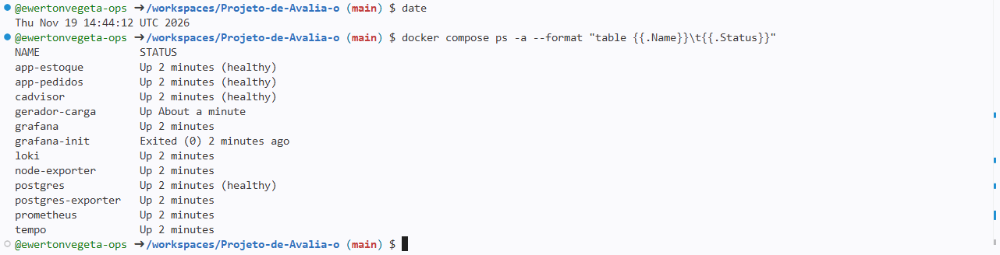
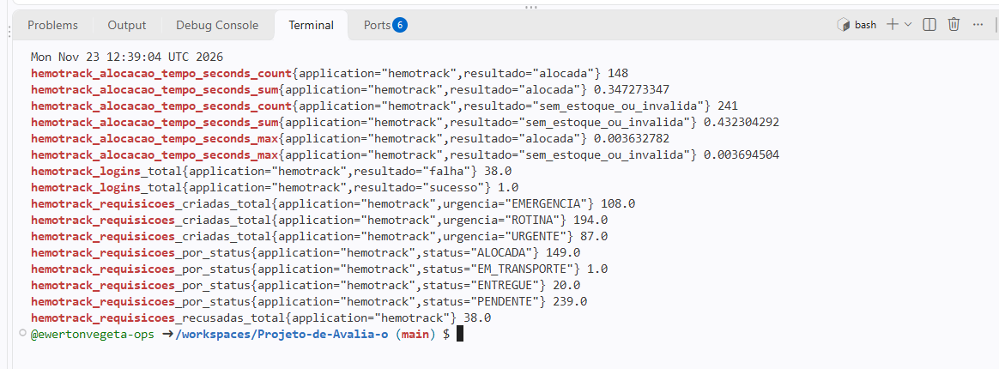
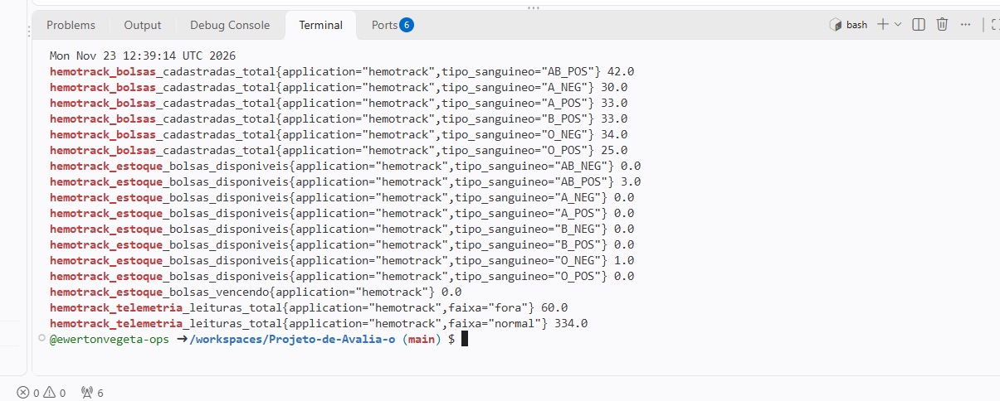
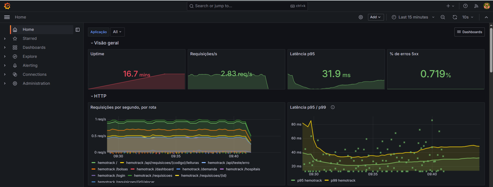
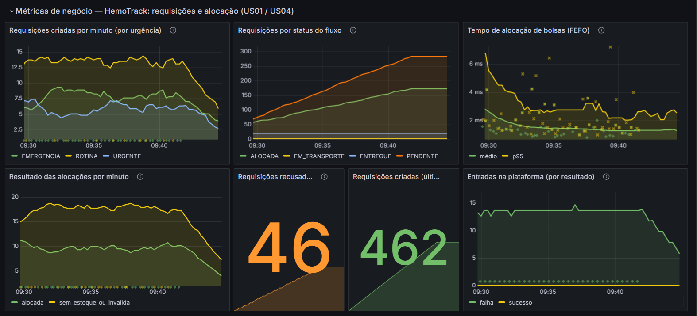
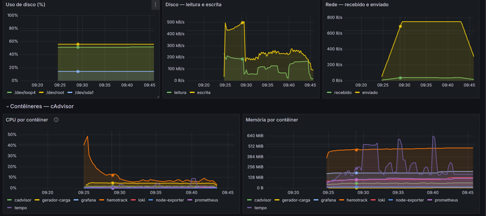
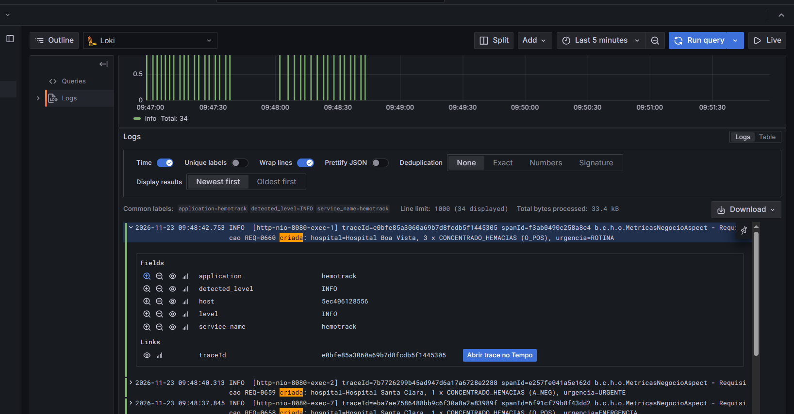
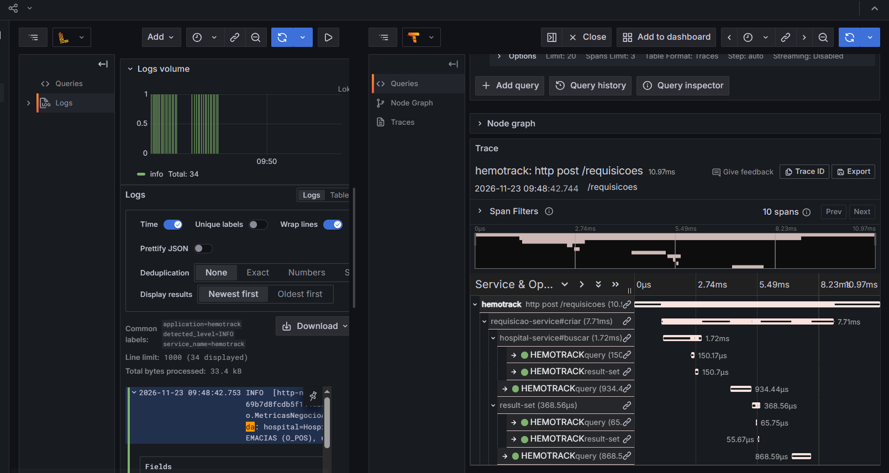
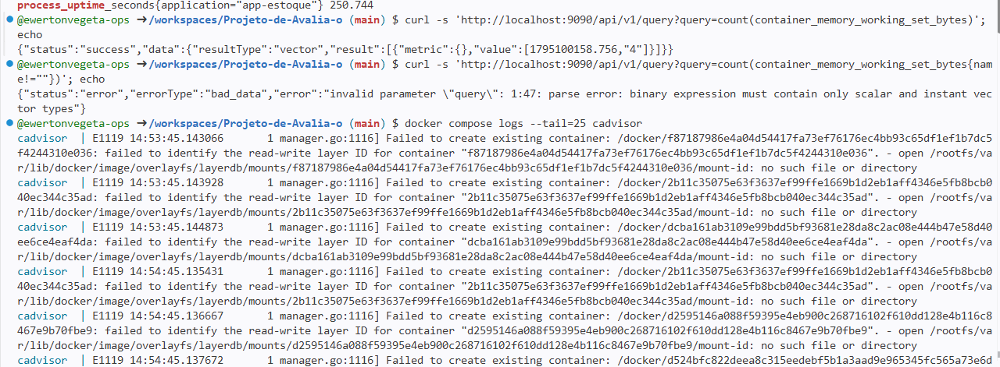

# 🩸 Observabilidade do HemoTrack
### Actuator · Prometheus · Grafana · Loki · Tempo

**CESAR School · Infraestrutura de Comunicação · Projeto de Avaliação**
Professor: Luiz Novaes · Novembro de 2026

| 📄 Relatório (PDF) | 🎬 Vídeo | 🖥️ Slides (PDF) | 🎤 Roteiro de fala (PDF) | 🔗 Aplicação do PI |
|:---:|:---:|:---:|:---:|:---:|
| [**Relatório**](Relatorio-Observabilidade-HemoTrack.pdf) | [**Vídeo no YouTube**](https://youtu.be/1w3fMaGJmjc) | [**Slides**](docs/apresentacao/Slides-Apresentacao-HemoTrack.pdf) | [HemoTrack](https://github.com/egs3-coder/HemoTrack) · cópia em [`apps/hemotrack`](apps/hemotrack) |
| 21 páginas, 24 figuras | 3 min, com legendas | 14 slides no visual do HemoTrack | 10 min, 2 apresentadores | Spring Boot 3.3.5 · Java 17 · H2 |

Este repositório instrumenta o **HemoTrack**, sistema web de gestão de hemocomponentes do nosso Projeto Integrador, com **métricas** (Actuator → Prometheus), **logs** (Loki) e **traces** (Tempo), tudo visualizado no **Grafana** e orquestrado com um único `docker compose up -d`. O código de negócio do HemoTrack **não foi alterado**: toda a instrumentação foi adicionada.

> **O que o enunciado pede no README e onde está:**
> pré-requisitos → [seção 2](#2-pré-requisitos) · comando para subir o ambiente → [seção 3](#3-como-subir-o-ambiente) · portas/URLs de cada serviço → [seção 4](#4-portas-e-urls) · lista das métricas de negócio → [seção 5](#5-métricas-de-negócio-ponto-adicional)

---

## Sumário

1. [Guia rápido para o professor](#1-guia-rápido-para-o-professor)
2. [Pré-requisitos](#2-pré-requisitos)
3. [Como subir o ambiente](#3-como-subir-o-ambiente)
4. [Portas e URLs](#4-portas-e-urls)
5. [Métricas de negócio (ponto adicional)](#5-métricas-de-negócio-ponto-adicional)
6. [Acesso remoto ao Grafana](#6-acesso-remoto-ao-grafana)
7. [Mapa da avaliação: onde está cada requisito](#7-mapa-da-avaliação-onde-está-cada-requisito)
8. [Roteiro de verificação no Grafana (passo a passo)](#8-roteiro-de-verificação-no-grafana-passo-a-passo)
9. [Arquitetura](#9-arquitetura)
10. [O que foi instrumentado no HemoTrack](#10-o-que-foi-instrumentado-no-hemotrack)
11. [Segurança mínima (R5)](#11-segurança-mínima-r5)
12. [Evidências (prints de 23/11/2026)](#12-evidências-prints-de-23112026)
13. [Vídeo de apresentação](#13-vídeo-de-apresentação)
14. [Dificuldades encontradas](#14-dificuldades-encontradas)
15. [Estrutura do repositório](#15-estrutura-do-repositório)
16. [Equipe](#16-equipe)

---

## 1. Guia rápido para o professor

| # | O que fazer | Onde |
|---|---|---|
| 0 | Assistir ao vídeo (3 min) | [youtu.be/1w3fMaGJmjc](https://youtu.be/1w3fMaGJmjc) |
| 1 | Ler o relatório | [`Relatorio-Observabilidade-HemoTrack.pdf`](Relatorio-Observabilidade-HemoTrack.pdf) (cópia em [`docs/relatorio.pdf`](docs/relatorio.pdf)) |
| 2 | Entrar no Grafana com o usuário **Viewer** | [Seção 6](#6-acesso-remoto-ao-grafana) |
| 3 | Seguir o roteiro (dashboards, Loki, Tempo, log → trace) | [Seção 8](#8-roteiro-de-verificação-no-grafana-passo-a-passo) |
| 4 | Conferir o código e a configuração de cada requisito | [Seção 7](#7-mapa-da-avaliação-onde-está-cada-requisito) |
| 5 | Ver o código de instrumentação do HemoTrack | [`apps/hemotrack/.../observabilidade/`](apps/hemotrack/src/main/java/br/com/hemotrack/observabilidade) |

O ambiente tem **9 contêineres** e **7 targets** no Prometheus. São **3 dashboards** provisionados, o HemoTrack expõe **9 métricas de negócio**, e os traces seguem o caminho **HTTP → serviço → banco**.

---

## 2. Pré-requisitos

Docker 24+ com Docker Compose v2 e cerca de 3 GB de RAM livres. Não é preciso ter Java nem Maven instalados, porque o HemoTrack é compilado dentro do Docker. Funciona em Linux, Docker Desktop (Windows 10 22H2+ / macOS) ou GitHub Codespaces.

| Requisito | Versão |
|---|---|
| Docker Engine / Docker Desktop | 24 ou mais novo |
| Docker Compose | v2 (`docker compose version`) |
| Git | qualquer versão recente |
| Memória livre | cerca de 3 GB |
| Java / Maven | **não precisa**: o build roda dentro do Docker |

---

## 3. Como subir o ambiente

```bash
git clone https://github.com/egs3-coder/Projeto-de-Avalia-o.git
cd Projeto-de-Avalia-o

cp .env.example .env              # troque as senhas (o .env NÃO é versionado)
docker compose up -d --build      # sobe tudo (o primeiro build leva de 5 a 10 min)
docker compose ps                 # hemotrack "healthy"; grafana-init "Exited (0)"

# acesso remoto (URL https pública só para o Grafana)
docker compose --profile remoto up -d
docker compose logs cloudflared | grep trycloudflare
```

**Comandos de validação:**

```bash
# R1: endpoint Prometheus com a tag application + métricas de negócio
curl -s http://localhost:8081/actuator/prometheus | grep -E '^hemotrack_' | grep -v bucket
curl -s http://localhost:8081/actuator/prometheus | grep -E '^(hikaricp_connections_active|process_uptime_seconds|http_server_requests_seconds_count)' | head

# todos os targets UP
curl -s http://localhost:9090/api/v1/targets | grep -o '"health":"[a-z]*"' | sort | uniq -c

# o próprio HemoTrack (login: operador / hemotrack123)
# http://localhost:8080
```

**Usuários do HemoTrack** (criados pelo `DadosIniciais`, senha `hemotrack123`): `hospital`, `operador`, `logistica` e `gestor`.

**Parar:** `docker compose --profile remoto down` (mantém os dados) ou `docker compose --profile remoto down -v` (apaga os volumes).

---

## 4. Portas e URLs

| Serviço | URL local | Exposição | O que verificar |
|---|---|---|---|
| **Grafana** | http://localhost:3000 | **pública** (única, via túnel) | Pasta *Projeto Integrador* |
| Prometheus | http://localhost:9090/targets | só `127.0.0.1` | 7 targets UP |
| HemoTrack: telas | http://localhost:8080 | só `127.0.0.1` | Login `operador` / `hemotrack123` |
| HemoTrack: Actuator | http://localhost:8081/actuator/prometheus | só `127.0.0.1` | `hemotrack_*`, `http_server_requests_*`, `hikaricp_*` |
| Loki | http://localhost:3100/ready | só `127.0.0.1` | `ready` |
| Tempo | http://localhost:3200/ready (OTLP :4318) | só `127.0.0.1` / rede interna | `ready` |
| node-exporter / cAdvisor | :9100 / :8080 | só rede interna do Docker | coletados pelo Prometheus |

---

## 5. Métricas de negócio (ponto adicional)

| Métrica no Prometheus | Tipo | O que mede | História |
|---|---|---|---|
| `hemotrack_requisicoes_criadas_total{urgencia}` | Counter | Requisições de hemocomponentes criadas (ROTINA / URGENTE / EMERGENCIA) | US01 |
| `hemotrack_requisicoes_recusadas_total` | Counter | Requisições recusadas pela validação | US01 |
| `hemotrack_requisicoes_por_status{status}` | Gauge | Requisições em cada etapa (PENDENTE, ALOCADA, EM_TRANSPORTE, ENTREGUE) | US11 |
| `hemotrack_alocacao_tempo_seconds_*{resultado}` | Timer | Tempo da alocação FEFO e resultado (alocada / sem estoque) | US04 |
| `hemotrack_estoque_bolsas_disponiveis{tipo_sanguineo}` | Gauge | Bolsas disponíveis e dentro da validade, por tipo ABO/Rh | US03 |
| `hemotrack_estoque_bolsas_vencendo` | Gauge | Bolsas que vencem nos próximos 7 dias (risco de descarte) | US10 |
| `hemotrack_bolsas_cadastradas_total{tipo_sanguineo}` | Counter | Entrada de bolsas no estoque | US03 |
| `hemotrack_telemetria_leituras_total{faixa}` | Counter | Leituras do sensor de temperatura: normal ou fora da faixa segura | US06 |
| `hemotrack_logins_total{resultado}` | Counter | Entradas na plataforma: sucesso ou falha | US02 |

```java
// MetricasNegocioAspect.java: conta cada requisição criada, por urgência, sem alterar o RequisicaoService
@AfterReturning(pointcut = "execution(* br.com.hemotrack.service.RequisicaoService.criar(..))", returning = "requisicao")
public void requisicaoCriada(Requisicao requisicao) {
    Counter.builder("hemotrack.requisicoes.criadas")
            .description("Requisicoes de hemocomponentes criadas, por urgencia")
            .tag("urgencia", requisicao.getUrgencia().name())
            .register(registry)
            .increment();
}
```

---

## 6. Acesso remoto ao Grafana

| Item | Valor |
|---|---|
| **URL** | informada na atividade do **Google Classroom** (Cloudflare Tunnel, HTTPS) |
| **Usuário** | `professor` (papel **Viewer**: só leitura) |
| **Senha** | informada na atividade do **Google Classroom** (não fica no repositório) |
| **Período** | **segunda-feira, 23/11/2026, a partir das 19h** (horário de Brasília) |

- Depois do login, o Grafana abre direto no dashboard **HemoTrack**. Os outros estão em **☰ → Dashboards → Projeto Integrador**.
- O usuário Viewer pode usar o **Explore** (☰ → Explore) para fazer consultas em PromQL, LogQL e TraceQL, mas não consegue salvar alterações.
- Um contêiner `gerador-carga` usa o HemoTrack o tempo todo como um operador do hemocentro: entra no sistema, cria requisições, aloca bolsas, cadastra bolsas, envia leituras de temperatura e gera erros de propósito. Assim sempre há dados novos.

---

## 7. Mapa da avaliação: onde está cada requisito

| Etapa | Requisito | Onde conferir no código | Onde ver funcionando |
|---|---|---|---|
| **E1** (0,75) | **R1**: Actuator + `micrometer-registry-prometheus`; endpoints `health`, `info`, `metrics` e `prometheus`; tag `application` | [`pom.xml`](apps/hemotrack/pom.xml) (bloco *Observabilidade*) · [`application.properties`](apps/hemotrack/src/main/resources/application.properties) (final do arquivo) | `curl localhost:8081/actuator/prometheus` |
| **E1** | **R2**: métricas HTTP, JVM, CPU, uptime e HikariCP | automáticas do Actuator/Micrometer (o HemoTrack usa HikariCP com H2) | Dashboard **HemoTrack**, linhas HTTP, JVM e HikariCP |
| **E2** (0,75) | **R3**: Node Exporter e cAdvisor | serviços `node-exporter` e `cadvisor` no [`docker-compose.yml`](docker-compose.yml) | Dashboard **Infraestrutura** |
| **E3** (0,75) | **R4**: um único `docker compose up -d`; um job por app e por exporter; datasources provisionados | [`docker-compose.yml`](docker-compose.yml) · [`prometheus.yml`](prometheus/prometheus.yml) · [`datasource.yml`](grafana/provisioning/datasources/datasource.yml) | Prometheus → Status → Targets |
| **E4** (0,75) | **R4**: dashboards de aplicação e de infraestrutura, com o JSON no repositório | [`grafana/dashboards/`](grafana/dashboards) · [`dashboards.yml`](grafana/provisioning/dashboards/dashboards.yml) | ☰ → Dashboards → Projeto Integrador |
| **E5** (0,75) | **R6**: logs no Loki, filtráveis por aplicação | [`logback-spring.xml`](apps/hemotrack/src/main/resources/logback-spring.xml) (appender loki4j) · [`loki.yml`](loki/loki.yml) | Explore → Loki → `{application="hemotrack"}` |
| **E6** (0,75) | **R6**: traces com vários spans e navegação log → trace | dependências OTel no [`pom.xml`](apps/hemotrack/pom.xml) · spans de serviço em [`MetricasNegocioAspect.java`](apps/hemotrack/src/main/java/br/com/hemotrack/observabilidade/MetricasNegocioAspect.java) · [`tempo.yml`](tempo/tempo.yml) · *derived field* no [`datasource.yml`](grafana/provisioning/datasources/datasource.yml) | Explore → Loki → expandir log → **Abrir trace no Tempo** |
| **E7** (0,75) | **R7**: acesso remoto com usuário Viewer | serviço `cloudflared` no [`docker-compose.yml`](docker-compose.yml) · [`criar-viewer.sh`](grafana/init/criar-viewer.sh) | [Seção 6](#6-acesso-remoto-ao-grafana) |
| **E8** (0,75) | Repositório, README e PDF | este README · [`docs/relatorio.pdf`](docs/relatorio.pdf) | — |
| **Adicional** (+1,00) | ≥ 2 métricas de negócio, com painel próprio | [`MetricasNegocioAspect.java`](apps/hemotrack/src/main/java/br/com/hemotrack/observabilidade/MetricasNegocioAspect.java) · [`MetricasEstoque.java`](apps/hemotrack/src/main/java/br/com/hemotrack/observabilidade/MetricasEstoque.java) | Dashboard **HemoTrack**, linhas "Métricas de negócio" |
| — | **R5**: segurança mínima | [`docker-compose.yml`](docker-compose.yml) (portas em `127.0.0.1`) · [`.gitignore`](.gitignore) · [`.env.example`](.env.example) | [Seção 11](#11-segurança-mínima-r5) |

---

## 8. Roteiro de verificação no Grafana (passo a passo)

### Passo 1: Dashboard do HemoTrack (E1, E4 e adicional)
1. Faça login. O dashboard **"Projeto Integrador — HemoTrack (JVM / HTTP / Negócio)"** abre automaticamente.
2. Role a página e confira cada linha:
   - **Visão geral:** uptime, req/s, latência p95 e % de erros 5xx.
   - **HTTP:** req/s por rota (`/requisicoes`, `/bolsas`, `/api/requisicoes/{codigo}/leituras`...), p95/p99 (os pontos são *exemplars*: clique num ponto para abrir o trace), taxa de 5xx e respostas por status.
   - **JVM:** heap, non-heap, threads, pausas de GC, CPU e classes carregadas.
   - **Banco de dados — pool HikariCP:** conexões ativas, ociosas e aguardando, e tempo para obter conexão.
   - **Métricas de negócio — requisições e alocação:** requisições por urgência, requisições por status, tempo de alocação FEFO, resultado das alocações, recusadas e logins.
   - **Métricas de negócio — estoque e telemetria:** estoque por tipo sanguíneo, bolsas cadastradas, leituras de temperatura (normal ou fora da faixa) e bolsas vencendo em 7 dias.
   - **Logs (Loki):** logs do HemoTrack.

### Passo 2: Dashboard de Infraestrutura (E2 e E4)
☰ → **Dashboards** → **Projeto Integrador** → **"Projeto Integrador — Infraestrutura (Host / Contêineres)"**. O dashboard mostra os targets UP, o host via Node Exporter (CPU, load, memória, disco e rede) e cada contêiner via cAdvisor (CPU, memória, rede e tempo no ar).

### Passo 3: Logs no Loki com LogQL (E5)
1. ☰ → **Explore** → no seletor do topo, escolha **Loki**.
2. À direita da caixa de consulta, clique em **Code** e cole uma das consultas abaixo:

   | Consulta | O que mostra |
   |---|---|
   | `{application="hemotrack"}` | todos os logs do HemoTrack |
   | `{application="hemotrack", level="ERROR"}` | só os erros |
   | `{application="hemotrack", level="WARN"}` | avisos: temperatura fora da faixa, alocação sem estoque, login inválido |
   | `{application="hemotrack"} \|= "Requisicao"` | ciclo de vida das requisições |
   | `{application="hemotrack"} \|= "Temperatura FORA"` | alertas do sensor de temperatura (US06) |
   | `sum by (level) (count_over_time({application="hemotrack"}[1m]))` | volume de logs por nível |

3. Clique em **Run query**.

### Passo 4: Navegação log → trace (E6)
1. Na consulta `{application="hemotrack"} |= "criada"`, clique numa linha **"Requisicao REQ-... criada"** para expandir.
2. Em **Links**, ao lado do `traceId`, clique em **"Abrir trace no Tempo"**.
3. A tela se divide: o **log à esquerda** e o **trace à direita**.

### Passo 5: Trace com vários spans (E6)
O trace de criação de uma requisição mostra o caminho **controller → serviço → banco**:

```
hemotrack  http post /requisicoes                     (RequisicaoController#criar)
└─ RequisicaoService#criar                            (span de serviço)
   ├─ HospitalService#buscar
   │  └─ query (SELECT hospital)                       (JDBC no H2)
   ├─ query (SELECT última requisição → próximo REQ-xxxx)
   └─ query (INSERT requisicao)
```

Para buscar direto: Explore → **Tempo** → aba **TraceQL** → `{resource.service.name="hemotrack" && name="http post /requisicoes"}`. Também dá para buscar a alocação FEFO (`name="http post /requisicoes/{id}/alocar"`) e a telemetria (`name="http post /api/requisicoes/{codigo}/leituras"`).

### Passo 6: Dashboard de Logs e Traces (extra)
☰ → Dashboards → **"Projeto Integrador — Logs (Loki) e Traces (Tempo)"**: volume de logs por nível, logs de erro, traces recentes de criação de requisição, traces com erro e o mapa de serviços gerado pelo Tempo.

### Consultas PromQL úteis (Explore → Prometheus → Code)

| Painel | Consulta |
|---|---|
| Req/s por rota | `sum by (uri) (rate(http_server_requests_seconds_count{application="hemotrack"}[1m]))` |
| Latência p95 | `histogram_quantile(0.95, sum by (le) (rate(http_server_requests_seconds_bucket{application="hemotrack"}[5m])))` |
| Taxa de 5xx | `sum(rate(http_server_requests_seconds_count{application="hemotrack", status=~"5.."}[5m]))` |
| Heap em uso | `sum(jvm_memory_used_bytes{application="hemotrack", area="heap"})` |
| Requisições por urgência (/min) | `sum by (urgencia) (rate(hemotrack_requisicoes_criadas_total[5m])) * 60` |
| Estoque por tipo sanguíneo | `sum by (tipo_sanguineo) (hemotrack_estoque_bolsas_disponiveis)` |
| Tempo médio de alocação | `sum(rate(hemotrack_alocacao_tempo_seconds_sum[5m])) / sum(rate(hemotrack_alocacao_tempo_seconds_count[5m]))` |
| Leituras fora da faixa | `sum(rate(hemotrack_telemetria_leituras_total{faixa="fora"}[5m])) * 60` |
| CPU do host (%) | `100 - (avg(rate(node_cpu_seconds_total{mode="idle"}[5m])) * 100)` |
| CPU por contêiner | `sum by (name) (rate(container_cpu_usage_seconds_total{name!=""}[1m]))` |

---

## 9. Arquitetura


- O **Prometheus** faz *scrape* do `/actuator/prometheus` do HemoTrack (porta de gerenciamento 8081) e do `/metrics` dos exporters, pela rede interna do Docker.
- O HemoTrack **envia** os logs ao **Loki** (appender loki4j) e os spans ao **Tempo** (OTLP/HTTP, porta 4318).
- O **Grafana** consulta os três (PromQL, LogQL e TraceQL) e é o **único serviço exposto**, via Cloudflare Tunnel.
- O banco H2 do HemoTrack fica gravado no volume `hemotrack-dados`, então os dados sobrevivem a reinícios.

---

## 10. O que foi instrumentado no HemoTrack

O **código de negócio do HemoTrack não foi alterado**. Toda a instrumentação foi **adicionada**:

| Arquivo | O que foi feito |
|---|---|
| [`pom.xml`](apps/hemotrack/pom.xml) | + `spring-boot-starter-actuator`, `micrometer-registry-prometheus`, `micrometer-tracing-bridge-otel`, `opentelemetry-exporter-otlp`, `spring-boot-starter-aop`, `datasource-micrometer-spring-boot` (spans JDBC) e `loki-logback-appender` |
| [`application.properties`](apps/hemotrack/src/main/resources/application.properties) | + bloco "Observabilidade": Actuator na porta **8081**, endpoints `health,info,metrics,prometheus`, tag `application=${spring.application.name}`, histogramas p95/p99, amostragem de 100% e envio OTLP ao Tempo |
| [`logback-spring.xml`](apps/hemotrack/src/main/resources/logback-spring.xml) | **novo**: logs no console e no Loki, com labels `application`, `host` e `level`, e com `traceId` e `spanId` em cada linha |
| [`observabilidade/MetricasNegocioAspect.java`](apps/hemotrack/src/main/java/br/com/hemotrack/observabilidade/MetricasNegocioAspect.java) | **novo**: aspecto (AOP) que cria um **span para cada método dos serviços** e registra os counters e o timer de negócio, sem mexer nas classes do sistema |
| [`observabilidade/MetricasEstoque.java`](apps/hemotrack/src/main/java/br/com/hemotrack/observabilidade/MetricasEstoque.java) | **novo**: gauges de estoque e de requisições, atualizados a cada 15 s |
| [`observabilidade/ObservabilidadeConfig.java`](apps/hemotrack/src/main/java/br/com/hemotrack/observabilidade/ObservabilidadeConfig.java) | **novo**: filtra observações sem valor (scrapes do `/actuator`, tarefas agendadas e JDBC fora de requisição) |
| [`observabilidade/TesteErroController.java`](apps/hemotrack/src/main/java/br/com/hemotrack/observabilidade/TesteErroController.java) | **novo**: `GET /api/teste/erro` gera um HTTP 500 de propósito, para os painéis e logs de erro |
| [`Dockerfile`](apps/hemotrack/Dockerfile) | **novo**: build multi-stage (Maven + Temurin 17) |

O gerador de carga ([`loadgen/carga.sh`](loadgen/carga.sh)) entra como `operador` e simula o uso real das histórias de usuário: telas (US02/US07/US08), criação de requisições (US01), alocação FEFO (US04), entrada de bolsas (US03) e leituras do sensor (US06). A cada 10 ciclos, ele gera um **HTTP 500**, um **404**, uma requisição inválida e um **login com senha errada**.

---

## 11. Segurança mínima (R5)

| Exigência | Como foi atendida |
|---|---|
| Não expor `/actuator/**` na internet | O Actuator roda numa **porta própria (8081)**, separada das telas, e está publicado só em `127.0.0.1`. O Prometheus o lê pela rede interna. |
| Expor apenas o Grafana | Só a porta 3000 é publicada. Prometheus, Loki, Tempo e o HemoTrack ficam em `127.0.0.1`, e os exporters ficam só na rede interna. |
| Trocar a senha padrão `admin/admin` | A senha vem de `GRAFANA_ADMIN_PASSWORD` no `.env`, e o Compose **não sobe** sem ela (`${VAR:?}`). |
| `.env` fora do repositório | O `.env` está no [`.gitignore`](.gitignore); só o [`.env.example`](.env.example) é versionado. |
| Acesso do professor somente leitura | Usuário **Viewer** criado automaticamente por [`criar-viewer.sh`](grafana/init/criar-viewer.sh). O cadastro público e o acesso anônimo estão desativados. |

---

## 12. Evidências (prints de 23/11/2026)

| | |
|---|---|
|  **E3**: 9 contêineres no ar |  **E2/E3**: 7 targets UP |
|  **E1 + adicional**: métricas de negócio |  **Adicional**: estoque e telemetria |
|  **E4**: dashboard HemoTrack |  **Adicional**: painéis de negócio |
|  **E2/E4**: infraestrutura |  **E5**: LogQL no Explore |
|  **E6**: log com link para o trace |  **E6**: trace com 10 spans |

Todos os prints estão em [`docs/evidencias/`](docs/evidencias) e comentados no [relatório](Relatorio-Observabilidade-HemoTrack.pdf).

---

## 13. Vídeo de apresentação

🎬 **Assista no YouTube:** [https://youtu.be/1w3fMaGJmjc](https://youtu.be/1w3fMaGJmjc) (3 min 11 s)

[](https://youtu.be/1w3fMaGJmjc)

O vídeo percorre o trabalho na ordem das etapas, com um print por cena e uma legenda explicando o que aconteceu em cada processo:

| Tempo | Cena | Etapa |
|---|---|---|
| 0:00 | Abertura e equipe | — |
| 0:07 | Arquitetura do ambiente | — |
| 0:20 | `docker compose ps`: 9 contêineres no ar | E3 |
| 0:32 | `/actuator/prometheus`: métricas de negócio, estoque e telemetria | E1 + adicional |
| 0:56 | Métricas padrão: HTTP, JVM e HikariCP | E1 |
| 1:07 | Prometheus: 7 targets UP | E2/E3 |
| 1:16 | Consulta PromQL por tela | E3 |
| 1:28 | Dashboard do HemoTrack e painéis de negócio | E4 + adicional |
| 2:03 | Dashboard de infraestrutura | E2/E4 |
| 2:14 | Logs no Loki | E5 |
| 2:25 | Do log para o trace e o trace com 10 spans | E6 |
| 2:48 | Dificuldade: o trace que não abria | — |
| 3:02 | Encerramento | — |

A música de fundo foi composta por código para este vídeo (sem obras de terceiros).

---

## 14. Dificuldades encontradas

| Problema | Solução |
|---|---|
| Contexto de trace "vazando": cada thread reutilizava o mesmo `traceId` (`trace exceeds max size`) | O `open-in-view` do HemoTrack fazia o span de conexão JDBC fechar depois do span do serviço; mantidos só os spans de consulta (`jdbc.includes=QUERY,FETCH`) |
| Docker Desktop recusou o Windows da equipe (exige Windows 10 22H2+) | Ambiente executado no **GitHub Codespaces** |
| cAdvisor 0.49 sem dados no Docker 29 (`failed to identify the read-write layer ID`) | Atualizado para `ghcr.io/google/cadvisor:v0.57.0` |
| Relógio do computador ~3 min adiantado: consultas com `[1m]` vazias | Janelas de `[5m]` nos painéis de negócio; lição sobre sincronismo de relógio (NTP) |
| Cada scrape do Prometheus e cada tarefa agendada geravam traces sem valor | `ObservationPredicate` em [`ObservabilidadeConfig.java`](apps/hemotrack/src/main/java/br/com/hemotrack/observabilidade/ObservabilidadeConfig.java) |
| Instrumentar sem alterar o código de negócio do PI | Spans e métricas por **aspecto (AOP)**, num pacote separado |

| | |
|---|---|
|  |  |

---

## 15. Estrutura do repositório

```
├── apps/
│   └── hemotrack/            # HemoTrack (Projeto Integrador) + instrumentação + Dockerfile
│       └── src/main/java/br/com/hemotrack/observabilidade/   # código de observabilidade
├── prometheus/prometheus.yml # jobs de scrape
├── loki/loki.yml             # Loki (logs)
├── tempo/tempo.yml           # Tempo (traces) + metrics generator
├── grafana/
│   ├── provisioning/         # datasources (Prometheus, Loki, Tempo) e provider de dashboards
│   ├── dashboards/           # JSON dos 3 dashboards
│   └── init/criar-viewer.sh  # cria o usuário Viewer do professor
├── loadgen/carga.sh          # gerador de carga contínuo (simula um operador do hemocentro)
├── scripts/                  # gerador dos dashboards
├── docs/                     # relatório, diagrama, evidências (prints), vídeo e apresentação (slides + roteiro)
├── docker-compose.yml
├── .env.example
├── Relatorio-Observabilidade-HemoTrack.pdf   # 📄 relatório
└── README.md
```

---

## 16. Equipe

| Integrante | Papel |
|---|---|
| Ewerton Guilherme da Silva | Product Owner |
| Pablo Arthur Eustáquio de Lima | Backend Developer |
| João Ricardo Alves de Brito | Backend Developer |
| Lucas Aprigio dos Santos | Backend Developer |
| Saulo Eduardo Almeida dos Santos | Backend Developer |
| Thiago Cardozo da Conceição | Frontend / UI Designer |
| Eloi de Lima Sousa | Frontend / UI Designer |
