# Observabilidade com Actuator, Prometheus, Grafana, Loki e Tempo

**CESAR School · Infraestrutura de Comunicação · Projeto de Avaliação**
Professor: Luiz Novaes · Novembro de 2026

> ## 📄 [Abrir o relatório completo (PDF)](Relatorio-Observabilidade.pdf)
> O relatório tem 21 páginas, com a descrição, o diagrama, as métricas de negócio, 23 prints comentados, a segurança, o acesso remoto e as dificuldades.
> Este README é um **roteiro guiado**: cada requisito do enunciado aponta para o arquivo, o print e o lugar no Grafana onde ele pode ser conferido.

---

## Sumário

1. [Guia rápido para o professor](#1-guia-rápido-para-o-professor)
2. [Acesso remoto ao Grafana](#2-acesso-remoto-ao-grafana)
3. [Mapa da avaliação: onde está cada requisito](#3-mapa-da-avaliação-onde-está-cada-requisito)
4. [Roteiro de verificação no Grafana (passo a passo)](#4-roteiro-de-verificação-no-grafana-passo-a-passo)
5. [Arquitetura](#5-arquitetura)
6. [Aplicações e instrumentação](#6-aplicações-e-instrumentação)
7. [Métricas de negócio (ponto adicional)](#7-métricas-de-negócio-ponto-adicional)
8. [Evidências (prints)](#8-evidências-prints)
9. [Como executar o ambiente](#9-como-executar-o-ambiente)
10. [Portas e URLs](#10-portas-e-urls)
11. [Segurança mínima (R5)](#11-segurança-mínima-r5)
12. [Estrutura do repositório](#12-estrutura-do-repositório)
13. [Equipe](#13-equipe)

---

## 1. Guia rápido para o professor

Caminho sugerido para corrigir, que leva cerca de 10 minutos:

| # | O que fazer | Onde |
|---|---|---|
| 1 | Ler o relatório | [`Relatorio-Observabilidade.pdf`](Relatorio-Observabilidade.pdf) (cópia em [`docs/relatorio.pdf`](docs/relatorio.pdf)) |
| 2 | Entrar no Grafana com o usuário **Viewer** | [Seção 2](#2-acesso-remoto-ao-grafana) |
| 3 | Seguir o roteiro de verificação (dashboards, Loki, Tempo, log → trace) | [Seção 4](#4-roteiro-de-verificação-no-grafana-passo-a-passo) |
| 4 | Conferir o código e a configuração de cada requisito | [Seção 3](#3-mapa-da-avaliação-onde-está-cada-requisito) |
| 5 | Ver os prints com data e hora, sem precisar do ambiente no ar | [Seção 8](#8-evidências-prints) e [`docs/evidencias/`](docs/evidencias) |

**Resumo em números:**

| 12 contêineres | 9/9 targets UP | 3 dashboards | 8 métricas de negócio | 16 spans num único trace |
|:---:|:---:|:---:|:---:|:---:|

---

## 2. Acesso remoto ao Grafana

| Item | Valor |
|---|---|
| **URL** | https://electronic-douglas-accommodation-short.trycloudflare.com |
| **Usuário** | `professor` (papel **Viewer**: só leitura) |
| **Senha** | informada na atividade do **Google Classroom** (não fica no repositório) |
| **Período** | **segunda-feira, 23/11/2026, a partir das 19h** (horário de Brasília) |

> ⚠️ A URL é gerada pelo **Cloudflare Tunnel** (*quick tunnel*) e **muda se o túnel for reiniciado**. Nesse caso, a URL atualizada será publicada na atividade do Google Classroom antes do início da janela de acesso.

- Depois do login, o Grafana abre direto no dashboard **Aplicações**. Os outros dois estão em **☰ → Dashboards → Projeto Integrador**.
- O usuário Viewer pode usar o **Explore** (☰ → Explore) para fazer consultas próprias em PromQL, LogQL e TraceQL, mas não consegue salvar alterações.
- Um contêiner `gerador-carga` gera tráfego contínuo, incluindo erros 500 e 404, então sempre há dados novos nos gráficos, nos logs e nos traces.

---

## 3. Mapa da avaliação: onde está cada requisito

| Etapa | Requisito | Onde conferir no código | Onde ver funcionando | Print |
|---|---|---|---|---|
| **E1** (0,75) | **R1**: Actuator + `micrometer-registry-prometheus`, endpoints `health`, `info`, `metrics` e `prometheus`, tag `application` | [`pom.xml` pedidos](apps/app-pedidos/pom.xml) · [`pom.xml` estoque](apps/app-estoque/pom.xml) · [`application.yml`](apps/app-pedidos/src/main/resources/application.yml) (bloco `management`) | `curl localhost:8081/actuator/prometheus` | [02](docs/evidencias/02-actuator-app-pedidos.png) · [03](docs/evidencias/03-actuator-app-estoque.png) |
| **E1** | **R2**: métricas HTTP, JVM, CPU, uptime e HikariCP | automáticas do Actuator/Micrometer; `percentiles-histogram` no [`application.yml`](apps/app-pedidos/src/main/resources/application.yml) | Dashboard **Aplicações** | [06](docs/evidencias/06-dashboard-aplicacoes-http.png) · [06b](docs/evidencias/06b-dashboard-aplicacoes-jvm.png) · [06c](docs/evidencias/06c-dashboard-aplicacoes-hikari-negocio-pedidos.png) |
| **E2** (0,75) | **R3**: Node Exporter, cAdvisor e (opcional) postgres_exporter | serviços `node-exporter`, `cadvisor` e `postgres-exporter` no [`docker-compose.yml`](docker-compose.yml) | Dashboard **Infraestrutura** | [08](docs/evidencias/08-dashboard-infra-host.png) · [08b](docs/evidencias/08b-dashboard-infra-conteineres.png) · [08c](docs/evidencias/08c-dashboard-infra-conteineres-postgres.png) |
| **E3** (0,75) | **R4**: tudo com um único `docker compose up -d`; um job por app e por exporter; datasources provisionados | [`docker-compose.yml`](docker-compose.yml) · [`prometheus.yml`](prometheus/prometheus.yml) · [`datasource.yml`](grafana/provisioning/datasources/datasource.yml) | Prometheus → Status → Targets | [01](docs/evidencias/01-docker-compose-ps.png) · [04](docs/evidencias/04-prometheus-targets.png) · [05](docs/evidencias/05-consulta-promql.png) |
| **E4** (0,75) | **R4**: dashboards de aplicação e de infraestrutura, com o JSON no repositório | [`grafana/dashboards/`](grafana/dashboards) (3 JSON) · [`dashboards.yml`](grafana/provisioning/dashboards/dashboards.yml) | ☰ → Dashboards → Projeto Integrador | [06](docs/evidencias/06-dashboard-aplicacoes-http.png) · [08](docs/evidencias/08-dashboard-infra-host.png) |
| **E5** (0,75) | **R6**: logs de todas as apps no Loki, filtráveis por aplicação | [`logback-spring.xml`](apps/app-pedidos/src/main/resources/logback-spring.xml) (appender loki4j) · [`loki.yml`](loki/loki.yml) | Explore → Loki → `{application="app-pedidos"}` | [09](docs/evidencias/09-loki-explore-logql.png) · [09b](docs/evidencias/09b-loki-explore-linhas.png) |
| **E6** (0,75) | **R6**: traces com vários spans no Tempo e navegação log → trace | dependências OTel nos `pom.xml` · [`tempo.yml`](tempo/tempo.yml) · *derived field* no [`datasource.yml`](grafana/provisioning/datasources/datasource.yml) | Explore → Loki → expandir log → **Abrir trace no Tempo** | [10](docs/evidencias/10-tempo-trace-16-spans.png) · [11](docs/evidencias/11-log-para-trace.png) |
| **E7** (0,75) | **R7**: acesso remoto com usuário Viewer | serviço `cloudflared` no [`docker-compose.yml`](docker-compose.yml) · [`criar-viewer.sh`](grafana/init/criar-viewer.sh) | [Seção 2](#2-acesso-remoto-ao-grafana) | relatório, seção 8 |
| **E8** (0,75) | Repositório, README e PDF | este README · [`docs/relatorio.pdf`](docs/relatorio.pdf) | — | — |
| **Adicional** (+1,00) | ≥ 2 métricas de negócio por app, com painel próprio | [`PedidoService.java`](apps/app-pedidos/src/main/java/br/com/projetointegrador/pedidos/PedidoService.java#L46-L67) · [`EstoqueService.java`](apps/app-estoque/src/main/java/br/com/projetointegrador/estoque/EstoqueService.java#L43-L72) | Dashboard **Aplicações**, linhas "Métricas de negócio" | [02](docs/evidencias/02-actuator-app-pedidos.png) · [06c](docs/evidencias/06c-dashboard-aplicacoes-hikari-negocio-pedidos.png) · [07](docs/evidencias/07-dashboard-negocio-estoque-logs.png) |
| — | **R5**: segurança mínima | [`docker-compose.yml`](docker-compose.yml) (portas em `127.0.0.1`) · [`.gitignore`](.gitignore) · [`.env.example`](.env.example) | [Seção 11](#11-segurança-mínima-r5) | — |

---

## 4. Roteiro de verificação no Grafana (passo a passo)

### Passo 1: Dashboard de Aplicações (E1, E4 e adicional)
1. Faça login. O dashboard **"Projeto Integrador — Aplicações (JVM / HTTP / Negócio)"** abre automaticamente.
2. No topo, a variável **Aplicação** filtra `app-pedidos`, `app-estoque` ou as duas. Ela usa a tag `application` (R1).
3. Role a página e confira cada linha:
   - **Visão geral:** uptime, req/s, latência p95 e % de erros 5xx.
   - **HTTP:** req/s por rota, p95/p99 (os pontos no gráfico são *exemplars*: clique num ponto para abrir o trace), taxa de 5xx e respostas por status.
   - **JVM:** heap, non-heap, threads, pausas de GC, CPU e classes carregadas.
   - **Banco de dados — pool HikariCP:** conexões ativas, ociosas e aguardando, e tempo para obter conexão.
   - **Métricas de negócio — app-pedidos / app-estoque:** os 8 painéis do ponto adicional.
   - **Logs (Loki):** logs das apps selecionadas.

### Passo 2: Dashboard de Infraestrutura (E2 e E4)
1. ☰ → **Dashboards** → **Projeto Integrador** → **"Projeto Integrador — Infraestrutura (Host / Contêineres)"**.
2. **Saúde da coleta:** targets UP e DOWN.
3. **Host — Node Exporter:** CPU, load average, memória, disco e rede.
4. **Contêineres — cAdvisor:** CPU, memória e rede **por contêiner**, e tempo no ar de cada um.
5. **Banco de dados — postgres_exporter:** conexões e transações por segundo.

### Passo 3: Logs no Loki com LogQL (E5)
1. ☰ → **Explore** → no seletor do topo, escolha **Loki**.
2. À direita da caixa de consulta, clique em **Code** e cole uma das consultas abaixo:

   | Consulta | O que mostra |
   |---|---|
   | `{application="app-pedidos"}` | todos os logs do app-pedidos |
   | `{application="app-estoque"}` | todos os logs do app-estoque |
   | `{application=~"app-.*", level="ERROR"}` | só os erros, das duas apps |
   | `{application="app-pedidos"} \|= "rejeitado"` | pedidos rejeitados por falta de estoque |
   | `sum by (application, level) (count_over_time({application=~"app-.*"}[1m]))` | volume de logs por app e nível |

3. Clique em **Run query**.

### Passo 4: Navegação log → trace (E6)
1. Na consulta `{application="app-pedidos"}`, clique numa linha **"Pedido ... aprovado"** para expandir.
2. Em **Links**, ao lado do `traceId`, clique em **"Abrir trace no Tempo"**.
3. A tela se divide: o **log à esquerda** e o **trace completo à direita**.

### Passo 5: Trace com vários spans (E6)
O trace aberto no passo 4 mostra o fluxo completo de um pedido, com cerca de 16 spans:

```
app-pedidos   http post /api/pedidos
└─ pedido-service#criar
   ├─ http post  ───────────────────────────►  app-estoque  http post /api/produtos/{id}/reservar
   │                                           └─ estoque-service#reservar
   │                                              └─ estoque-pool  query / result-set  (SQL)
   └─ pedidos-pool  query (INSERT do pedido)
```

Também dá para buscar traces direto: Explore → **Tempo** → aba **TraceQL** → `{resource.service.name="app-pedidos" && name="http post /api/pedidos"}`.

### Passo 6: Dashboard de Logs e Traces (extra)
☰ → Dashboards → **"Projeto Integrador — Logs (Loki) e Traces (Tempo)"**: volume de logs por nível, logs de erro, traces recentes, traces com erro e o **mapa de serviços** gerado automaticamente pelo Tempo.

### Consultas PromQL úteis (Explore → Prometheus → Code)

| Painel | Consulta |
|---|---|
| Req/s por rota | `sum by (uri) (rate(http_server_requests_seconds_count{application="app-pedidos"}[1m]))` |
| Latência p95 | `histogram_quantile(0.95, sum by (le) (rate(http_server_requests_seconds_bucket{application="app-pedidos"}[5m])))` |
| Taxa de 5xx | `sum by (application) (rate(http_server_requests_seconds_count{status=~"5.."}[5m]))` |
| Heap em uso | `sum by (application) (jvm_memory_used_bytes{area="heap"})` |
| Pedidos por minuto | `sum by (status) (rate(pedidos_criados_total[1m])) * 60` |
| Tempo médio do pedido | `rate(pedidos_processamento_seconds_sum[5m]) / rate(pedidos_processamento_seconds_count[5m])` |
| Reservas por resultado | `sum by (resultado) (rate(estoque_reservas_total[1m])) * 60` |
| CPU do host (%) | `100 - (avg(rate(node_cpu_seconds_total{mode="idle"}[5m])) * 100)` |
| CPU por contêiner | `sum by (name) (rate(container_cpu_usage_seconds_total{name!=""}[1m]))` |

---

## 5. Arquitetura


- O **Prometheus** faz *scrape* do `/actuator/prometheus` das aplicações (porta de gerenciamento 8081) e do `/metrics` dos exporters, tudo pela rede interna do Docker.
- As aplicações **enviam** os logs ao **Loki** (appender loki4j) e os spans ao **Tempo** (OTLP/HTTP, porta 4318).
- O **Grafana** consulta os três (PromQL, LogQL e TraceQL) e é o **único serviço exposto**, via Cloudflare Tunnel.
- O Tempo também gera métricas de *service graph* e as envia ao Prometheus por *remote write*. Isso alimenta o mapa de serviços.

---

## 6. Aplicações e instrumentação

| Aplicação | Responsabilidade | Endpoints |
|---|---|---|
| **app-pedidos** | Cria pedidos e chama o app-estoque para reservar os produtos | `POST /api/pedidos` · `GET /api/pedidos` · `GET /api/pedidos/{id}` · `GET /api/pedidos/erro` (gera 500) |
| **app-estoque** | Controla o estoque de produtos (PostgreSQL) | `GET /api/produtos` · `GET /api/produtos/{id}` · `POST /api/produtos/{id}/reservar?quantidade=N` · `POST /api/produtos/{id}/repor?quantidade=N` · `GET /api/produtos/erro` (gera 500) |

Spring Boot 3.3.5, Java 21, PostgreSQL 16. O que foi adicionado em cada aplicação:

| Pilar | Bibliotecas | Configuração |
|---|---|---|
| **Métricas** | `spring-boot-starter-actuator`, `micrometer-registry-prometheus` | Actuator na porta **8081**, endpoints `health,info,metrics,prometheus`, tag `application=${spring.application.name}` e histograma de `http.server.requests` |
| **Traces** | `micrometer-tracing-bridge-otel`, `opentelemetry-exporter-otlp`, `datasource-micrometer-spring-boot`, `spring-boot-starter-aop` | Amostragem de 100%, export OTLP para `http://tempo:4318/v1/traces`, `@Observed` nos serviços e spans de JDBC |
| **Logs** | `loki-logback-appender` (loki4j) | Labels `application`, `host` e `level`; `traceId` e `spanId` em todas as linhas |

O gerador de carga ([`loadgen/carga.sh`](loadgen/carga.sh)) roda o tempo todo. Ele cria pedidos, consulta listas e repõe o estoque, e a cada 10 ciclos chama os endpoints de erro (500) e um produto inexistente (404).

---

## 7. Métricas de negócio (ponto adicional)

São 4 métricas por aplicação, contra o mínimo de 2 pedido:

| App | Métrica no Prometheus | Tipo | O que mede | Código |
|---|---|---|---|---|
| app-pedidos | `pedidos_criados_total{status}` | Counter | Pedidos criados, por status (`aprovado` / `rejeitado`) | [PedidoService.java](apps/app-pedidos/src/main/java/br/com/projetointegrador/pedidos/PedidoService.java#L50-L57) |
| app-pedidos | `pedidos_processamento_seconds_*` | Timer | Tempo de processamento do pedido, incluindo a reserva no estoque (médio e p95) | [L61](apps/app-pedidos/src/main/java/br/com/projetointegrador/pedidos/PedidoService.java#L61-L63) |
| app-pedidos | `pedidos_em_processamento` | Gauge | Pedidos sendo processados no momento | [L64](apps/app-pedidos/src/main/java/br/com/projetointegrador/pedidos/PedidoService.java#L64-L66) |
| app-pedidos | `pedidos_itens_vendidos_total` | Counter | Unidades vendidas em pedidos aprovados | [L58](apps/app-pedidos/src/main/java/br/com/projetointegrador/pedidos/PedidoService.java#L58-L60) |
| app-estoque | `estoque_reservas_total{resultado}` | Counter | Reservas, por resultado (`sucesso` / `insuficiente`) | [EstoqueService.java](apps/app-estoque/src/main/java/br/com/projetointegrador/estoque/EstoqueService.java#L46-L53) |
| app-estoque | `estoque_reserva_tempo_seconds_*` | Timer | Tempo para processar uma reserva | [L60](apps/app-estoque/src/main/java/br/com/projetointegrador/estoque/EstoqueService.java#L60-L62) |
| app-estoque | `estoque_produtos_abaixo_minimo` | Gauge | Produtos com quantidade abaixo do estoque mínimo | [L66](apps/app-estoque/src/main/java/br/com/projetointegrador/estoque/EstoqueService.java#L66-L68) |
| app-estoque | `estoque_unidades_disponiveis` | Gauge | Soma das unidades disponíveis em estoque | [L69](apps/app-estoque/src/main/java/br/com/projetointegrador/estoque/EstoqueService.java#L69-L71) |

Também existem `estoque_unidades_reservadas_total` e `estoque_reposicoes_total` (Counters).

```java
// Counter com tag -> pedidos_criados_total{status="aprovado"}
this.pedidosAprovados = Counter.builder("pedidos.criados")
        .description("Total de pedidos criados, por status")
        .tag("status", "aprovado")
        .register(registry);

// Timer -> pedidos_processamento_seconds_count / _sum / _max / _bucket
this.tempoProcessamento = Timer.builder("pedidos.processamento")
        .description("Tempo de processamento de um pedido (inclui reserva no estoque)")
        .register(registry);
```

---

## 8. Evidências (prints)

Os prints foram feitos em **19/11/2026**, entre 11h44 e 12h11 (horário de Brasília), num **GitHub Codespaces** (Linux, 2 núcleos, 8 GB). Nos prints de terminal, o `date` mostra o horário do servidor em **UTC**. Todos os arquivos estão em [`docs/evidencias/`](docs/evidencias).

<details open>
<summary><b>E3: <code>docker compose ps</code> (12 serviços no ar)</b></summary>


</details>

<details>
<summary><b>E1: <code>/actuator/prometheus</code> de cada aplicação (tag <code>application</code> + métricas de negócio)</b></summary>

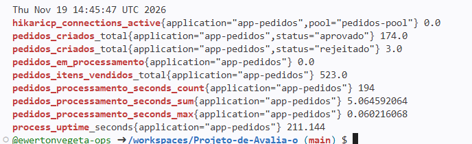
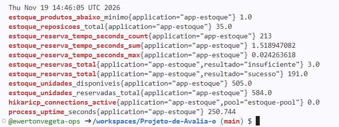
</details>

<details open>
<summary><b>E2/E3: Prometheus, Status → Targets (9/9 UP)</b></summary>

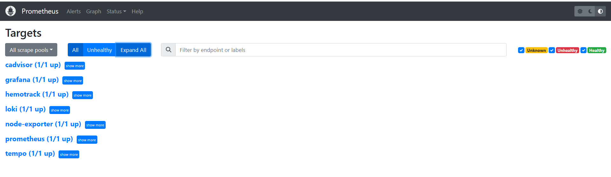
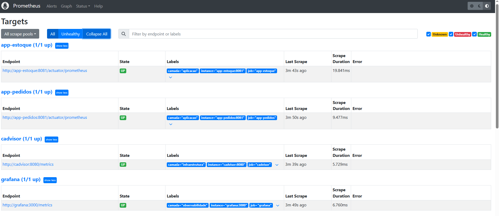
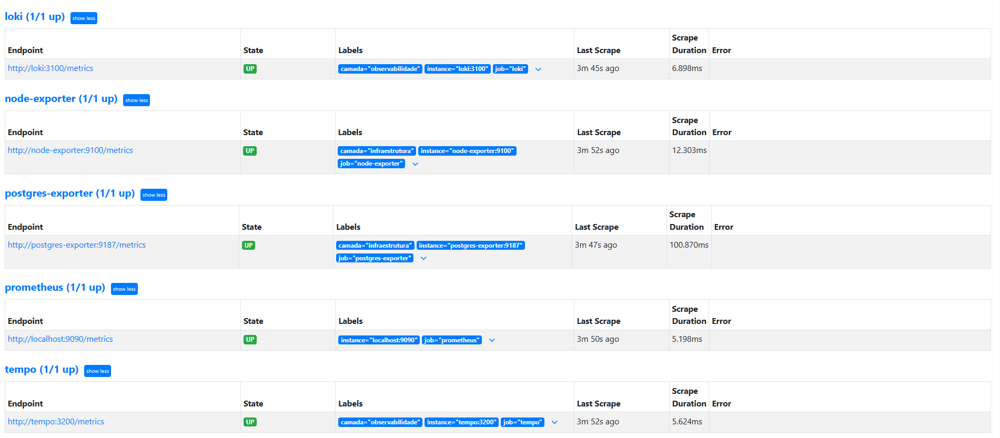
</details>

<details>
<summary><b>E3: consulta PromQL</b></summary>

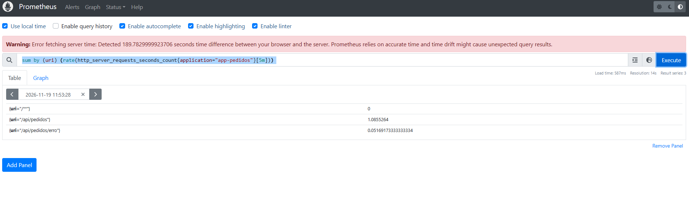
</details>

<details open>
<summary><b>E4 + adicional: dashboard de Aplicações</b></summary>

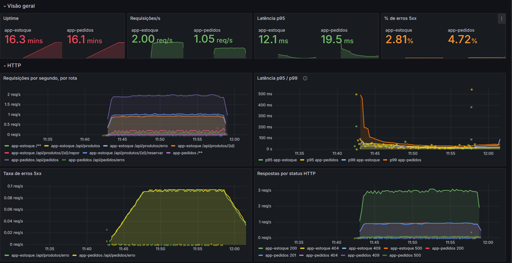
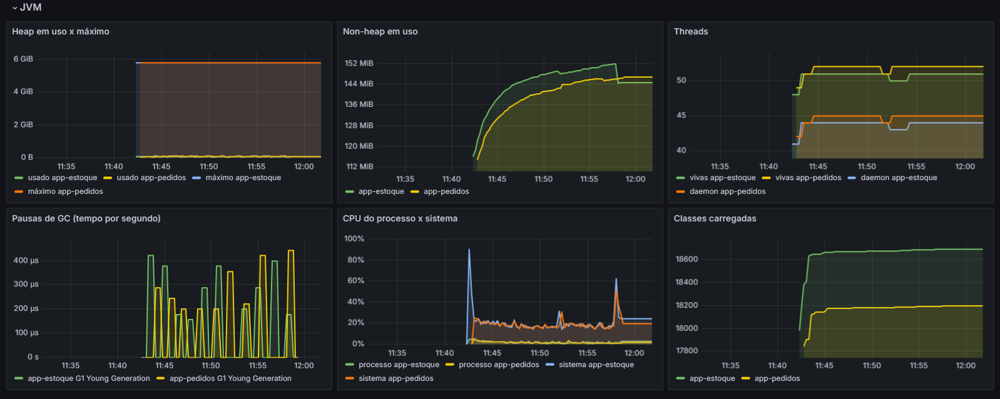
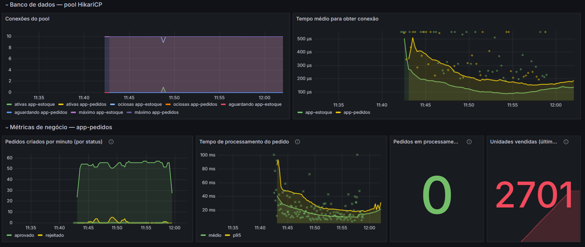
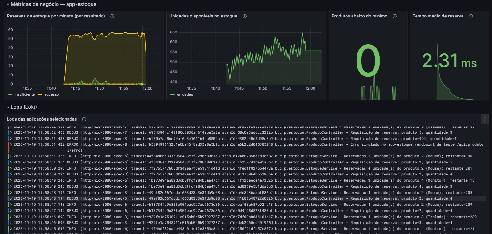
</details>

<details open>
<summary><b>E2/E4: dashboard de Infraestrutura</b></summary>

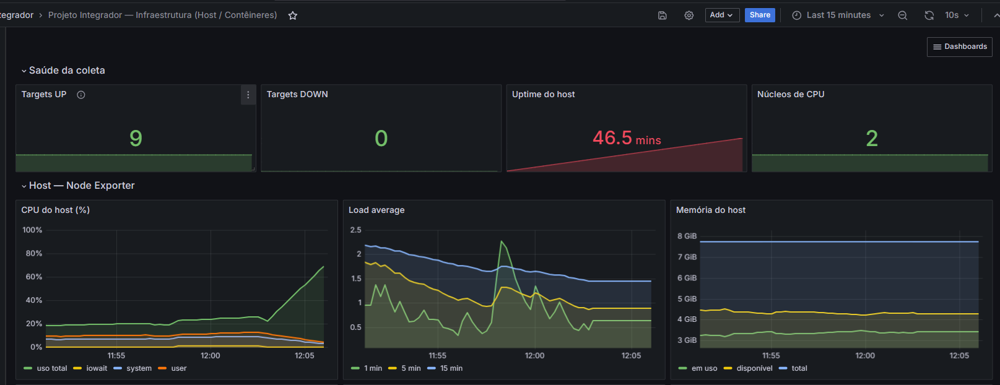

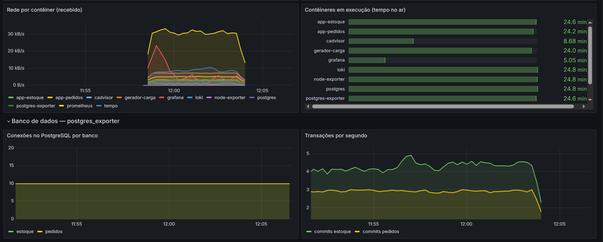
</details>

<details open>
<summary><b>E5: Loki, consulta LogQL no Explore</b></summary>

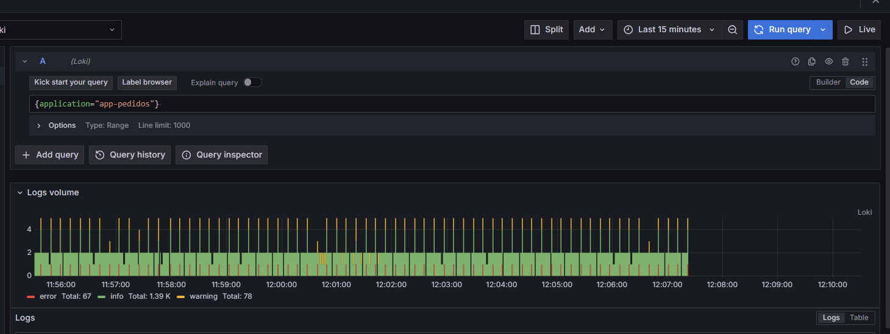
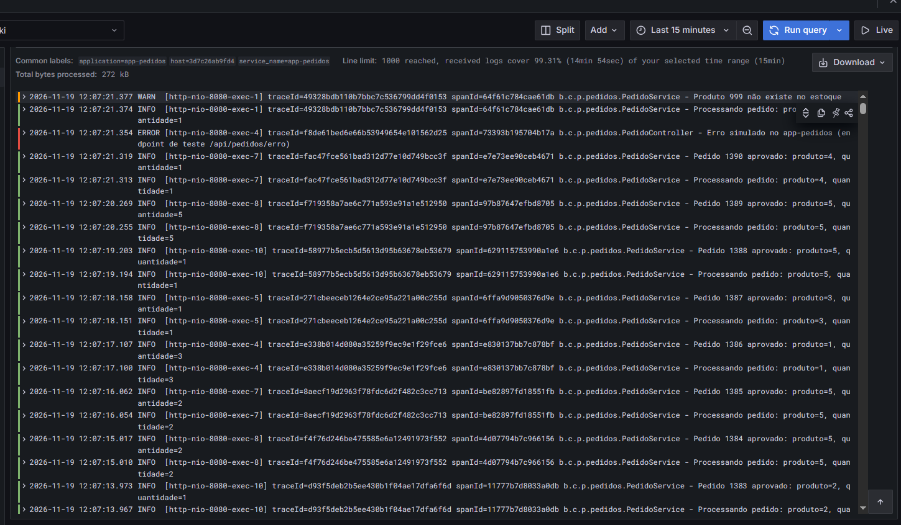
</details>

<details>
<summary><b>E5/E6: dashboard de Logs e Traces e mapa de serviços</b></summary>

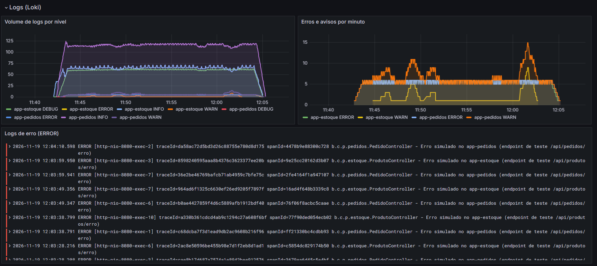
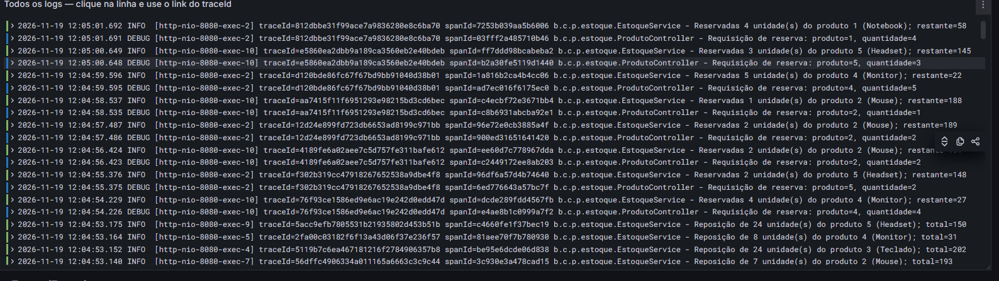
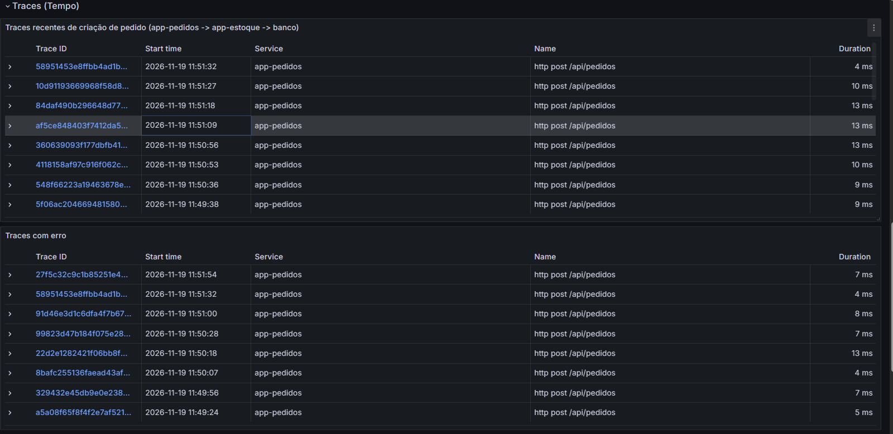
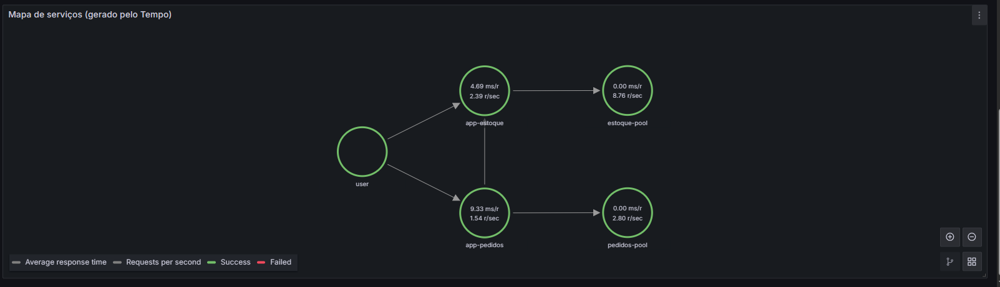
</details>

<details open>
<summary><b>E6: trace no Tempo (16 spans) e navegação log → trace</b></summary>

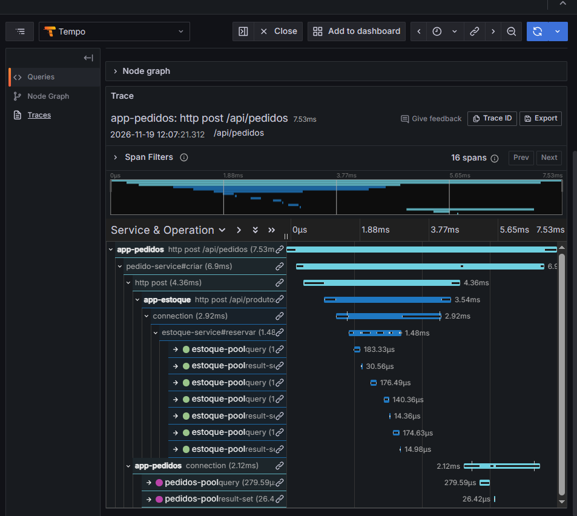

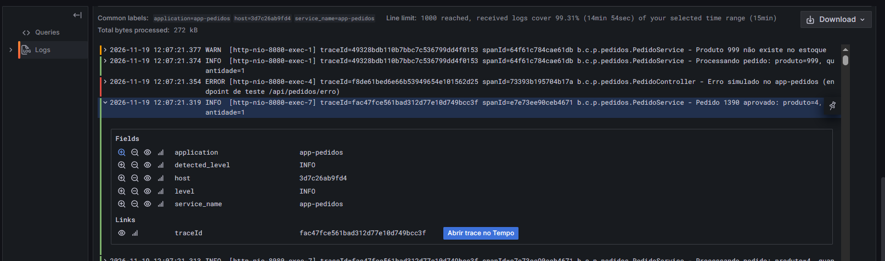
</details>

<details>
<summary><b>Dificuldades encontradas (detalhadas na seção 9 do relatório)</b></summary>

| Problema | Solução |
|---|---|
| Docker Desktop recusou o Windows da equipe (exige Windows 10 22H2+) | Ambiente executado no GitHub Codespaces |
| cAdvisor 0.49 sem dados no Docker 29 (`failed to identify the read-write layer ID`) | Atualizado para `ghcr.io/google/cadvisor:v0.57.0` |
| Relógio do computador ~3 min adiantado: consultas com `[1m]` vazias | Janela `[5m]`; lição sobre sincronismo de relógio (NTP) |

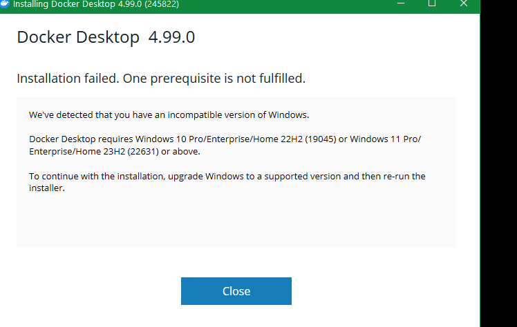

</details>

---

## 9. Como executar o ambiente

**Pré-requisitos:** Docker 24+ com Docker Compose v2 e cerca de 4 GB de RAM livres. Não é preciso ter Java nem Maven instalados, porque as imagens das aplicações são compiladas dentro do Docker (build multi-stage). Funciona em Linux, Docker Desktop (Windows 10 22H2+ / macOS) ou GitHub Codespaces.

```bash
git clone https://github.com/egs3-coder/Projeto-de-Avalia-o.git
cd Projeto-de-Avalia-o

# 1. Variáveis de ambiente (o .env NÃO é versionado)
cp .env.example .env        # troque as senhas

# 2. Subir tudo com um único comando
docker compose up -d --build

# 3. Conferir (aplicações "healthy"; grafana-init termina com "Exited (0)")
docker compose ps

# 4. Acesso remoto (opcional): URL https pública só para o Grafana
docker compose --profile remoto up -d
docker compose logs cloudflared | grep trycloudflare
```

A primeira subida leva de 5 a 10 minutos, por causa do build Maven. Para regerar os dashboards: `python3 scripts/gerar_dashboards.py`.

**Comandos de validação:**

```bash
# métricas de negócio e tag application
curl -s http://localhost:8081/actuator/prometheus | grep -E '^(pedidos_(criados|em_processamento|itens_vendidos)|hikaricp_connections_active)'
curl -s http://localhost:8083/actuator/prometheus | grep -E '^estoque_(reservas_total|unidades|produtos_abaixo)'

# todos os targets UP
curl -s http://localhost:9090/api/v1/targets | grep -o '"health":"[a-z]*"' | sort | uniq -c

# carga manual, incluindo erros
for i in $(seq 1 50); do curl -s -X POST localhost:8080/api/pedidos -H 'Content-Type: application/json' -d '{"produtoId":1,"quantidade":2}' >/dev/null; done
for i in $(seq 1 10); do curl -s localhost:8080/api/pedidos/erro >/dev/null; done
```

**Parar:** `docker compose --profile remoto down` (mantém os dados) ou `docker compose --profile remoto down -v` (apaga os volumes).

---

## 10. Portas e URLs

| Serviço | URL local | Exposição | O que verificar |
|---|---|---|---|
| **Grafana** | http://localhost:3000 | **pública** (única, via túnel) | Pasta *Projeto Integrador* |
| Prometheus | http://localhost:9090/targets | só `127.0.0.1` | Todos os targets UP |
| app-pedidos: API / Actuator | :8080 / :8081/actuator/prometheus | só `127.0.0.1` | `pedidos_*`, `http_server_requests_*`, `hikaricp_*` |
| app-estoque: API / Actuator | :8082 / :8083/actuator/prometheus | só `127.0.0.1` | `estoque_*` |
| Loki | http://localhost:3100/ready | só `127.0.0.1` | `ready` |
| Tempo | http://localhost:3200/ready (OTLP :4318) | só `127.0.0.1` / rede interna | `ready` |
| node-exporter / cAdvisor / postgres-exporter | :9100 / :8080 / :9187 | só rede interna do Docker | coletados pelo Prometheus |

---

## 11. Segurança mínima (R5)

| Exigência | Como foi atendida |
|---|---|
| Não expor `/actuator/**` na internet | O Actuator roda numa **porta própria (8081)**, separada da API, e está publicado só em `127.0.0.1`. O Prometheus o lê pela rede interna. |
| Expor apenas o Grafana | Só a porta 3000 é publicada. Prometheus, Loki e Tempo ficam em `127.0.0.1`, e os exporters ficam só na rede interna. |
| Trocar a senha padrão `admin/admin` | A senha vem de `GRAFANA_ADMIN_PASSWORD` no `.env`, e o Compose **não sobe** sem ela (`${VAR:?}`). |
| `.env` fora do repositório | O `.env` está no [`.gitignore`](.gitignore); só o [`.env.example`](.env.example) é versionado, sem segredos reais. |
| Acesso do professor somente leitura | Usuário **Viewer** criado automaticamente por [`criar-viewer.sh`](grafana/init/criar-viewer.sh). O cadastro público e o acesso anônimo estão desativados. |

---

## 12. Estrutura do repositório

```
├── apps/
│   ├── app-pedidos/          # Spring Boot 3.3 / Java 21 + Dockerfile
│   └── app-estoque/
├── prometheus/prometheus.yml # jobs de scrape (1 por app e por exporter)
├── loki/loki.yml             # Loki (logs)
├── tempo/tempo.yml           # Tempo (traces) + metrics generator
├── grafana/
│   ├── provisioning/         # datasources (Prometheus, Loki, Tempo) e provider de dashboards
│   ├── dashboards/           # JSON dos 3 dashboards
│   └── init/criar-viewer.sh  # cria o usuário Viewer do professor
├── loadgen/carga.sh          # gerador de carga contínuo
├── postgres/init.sql         # cria os bancos pedidos e estoque
├── scripts/                  # gerador dos dashboards
├── docs/
│   ├── relatorio.pdf         # 📄 relatório final
│   ├── arquitetura.png       # diagrama
│   └── evidencias/           # prints
├── docker-compose.yml
├── .env.example
├── Relatorio-Observabilidade.pdf   # 📄 relatório (mesmo arquivo de docs/relatorio.pdf)
└── README.md
```

---

## 13. Equipe

| Integrante | Papel |
|---|---|
| Ewerton Guilherme da Silva | Product Owner |
| Pablo Arthur Eustáquio de Lima | Backend Developer |
| João Ricardo Alves de Brito | Backend Developer |
| Lucas Aprigio dos Santos | Backend Developer |
| Saulo Eduardo Almeida dos Santos | Backend Developer |
| Thiago Cardozo da Conceição | Frontend / UI Designer |
| Eloi de Lima Sousa | Frontend / UI Designer |
